# MiniLang Lexical Analyzer & DFA Tracer

[](https://github.com/jullianaygrubay/minilang-lexical-analyzer/actions/workflows/tests.yml)

An interactive **Deterministic Finite Automaton (DFA)** lexical analyzer and desktop IDE built with Python and Tkinter for **MiniLang**.

## Features
- **Explicit DFA Engine (`lexer.py`):** Simulates states `q0`–`q8` and error sink `qe` with step-by-step transition logging.
- **Interactive Desktop IDE (`minilang_gui.py`):** Synchronized line numbers, live syntax highlighting, debounced auto-analysis, inline red error underlines with click-to-jump, Light/Dark themes (`Ctrl+T`), and CSV/TXT report export.

## DFA State Transition Diagram

```mermaid
stateDiagram-v2
    direction LR
    [*] --> q0

    q0 --> q1 : letter / _
    q1 --> q1 : letter / digit / _
    q1 --> [*] : Keyword or Identifier

    q0 --> q2 : digit
    q2 --> q2 : digit
    q2 --> [*] : INT_LITERAL
    q2 --> qe : . or letter (malformed number)

    q0 --> q3 : '"'
    q3 --> q3 : any char except '"' or newline
    q3 --> q4 : '"'
    q4 --> [*] : STRING_LITERAL
    q3 --> qe : newline or EOF (unclosed string)

    q0 --> q5 : '='
    q5 --> [*] : ASSIGN_OP

    q0 --> q6 : '-'
    q6 --> q7 : '>'
    q7 --> [*] : RETURN_ARROW
    q6 --> qe : other (expected '->')

    q0 --> q8 : delimiter ( ) { } : ; ,
    q8 --> [*] : DELIMITER

    q0 --> qe : unrecognized symbol
    qe --> [*] : LexicalError (panic-mode recovery)
```



## Quick Start
```bash
python minilang_gui.py
```

## Sample Files
- `samples/valid_demo.minilang` — Valid MiniLang functions, typed parameters, return arrows, and nested calls.
- `samples/error_demo.minilang` — Intentional lexical edge cases for testing DFA error sink (`qe`) recovery.