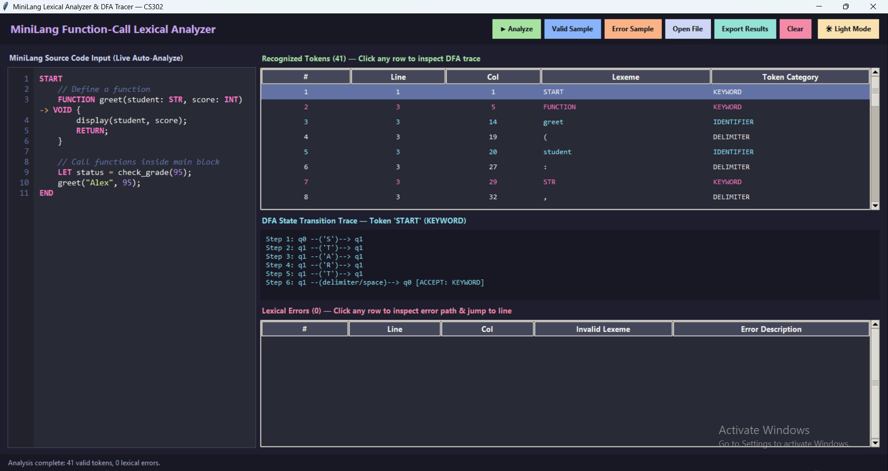
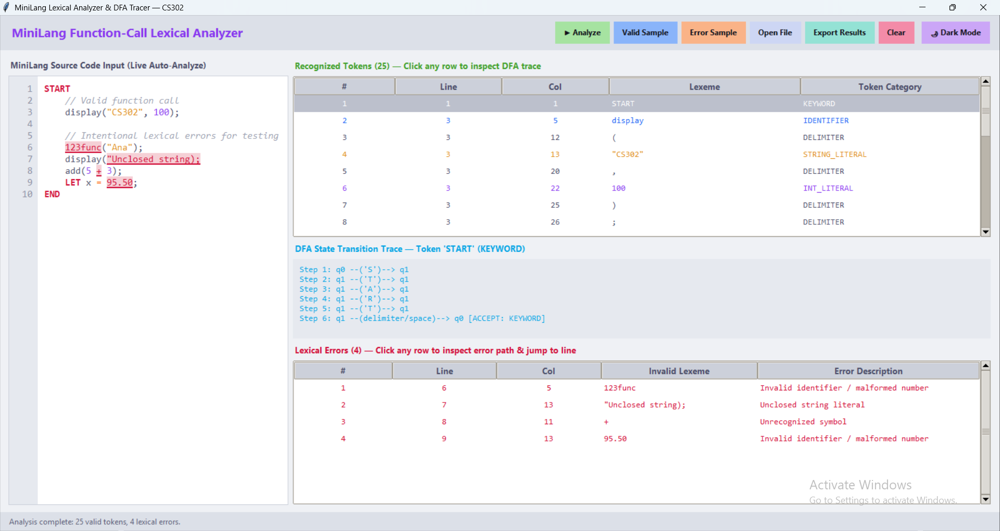
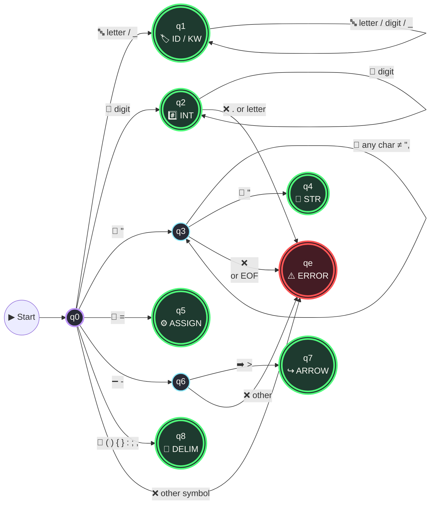

# MiniLang Lexical Analyzer & DFA Tracer

[](https://github.com/jullianaygrubay/minilang-lexical-analyzer/actions/workflows/tests.yml)

An explicit **Deterministic Finite Automaton (DFA)** lexical analyzer and interactive desktop IDE built with Python and Tkinter.

## Features

- **Explicit DFA Scanner (`lexer.py`):** Scans MiniLang source code across states `q0`–`q8` with panic-mode error recovery (`qe`) and line/column position tracking.
- **Interactive Desktop IDE (`minilang_gui.py`):** Features a code editor with synchronized line numbers, live syntax highlighting, debounced auto-analysis, inline error jump-to-line, Light/Dark theme switching (`Ctrl+T`), sample program loaders, and token/error inspection.
- **Export & Reporting:** Export lexical analysis results and token tables to CSV or TXT formats.
- **Automated Testing & CI:** Includes a `pytest` unit test suite (`tests/test_lexer.py`) integrated with GitHub Actions.
- **Standalone Windows Build:** Can be packaged into a single executable (`MiniLangAnalyzer.exe`) via PyInstaller without requiring Python on the target machine.

## Screenshots

| Dark Mode — Valid Program (`Ctrl+T`) | Light Mode — Lexical Error Recovery (`Ctrl+T`) |
| :---: | :---: |
|  |  |
| *Live syntax highlighting, DFA trace & token table* | *Panic-mode error detection (`qe`) and diagnostics* |

## DFA State Transition Diagram



## Lexical Token Specification

| Token Category | Accepting State | Pattern / Lexemes | Examples |
| :--- | :---: | :--- | :--- |
| **KEYWORD** | `q1` | `START`, `END`, `FUNCTION`, `LET`, `RETURN`, `IF`, `ELSE`, `WHILE`, `PRINT`, `display` | `START`, `FUNCTION`, `LET` |
| **DATA_TYPE** | `q1` | `INT`, `STR`, `FLOAT`, `BOOL`, `VOID` | `INT`, `STR`, `VOID` |
| **IDENTIFIER** | `q1` | `[a-zA-Z_][a-zA-Z0-9_]*` (excluding keywords & types) | `greet`, `score`, `check_grade` |
| **INT_LITERAL** | `q2` | `[0-9]+` | `0`, `95`, `100` |
| **STRING_LITERAL** | `q4` | `"[^"\n]*"` | `"Alex"`, `"CS302"` |
| **ASSIGN_OP** | `q5` | `=` | `=` |
| **RETURN_ARROW** | `q7` | `->` | `->` |
| **DELIMITER** | `q8` | `(`, `)`, `{`, `}`, `;`, `,`, `:` | `(`, `)`, `{`, `;`, `:` |
| **COMMENT** *(Ignored)* | `q6` | `//[^\n]*` | `// Define a function` |
| **LEXICAL_ERROR** | `qe` | Unclosed strings, invalid symbols, or malformed identifiers (e.g. `123func`, `95.50`, `+`) | `123func`, `"Unclosed string` |

## Quick Start
```bash
python minilang_gui.py
```

## Sample Files
- `samples/valid_demo.minilang` — Valid MiniLang functions, typed parameters, return arrows, and nested calls.
- `samples/error_demo.minilang` — Intentional lexical edge cases for testing DFA error sink (`qe`) recovery.